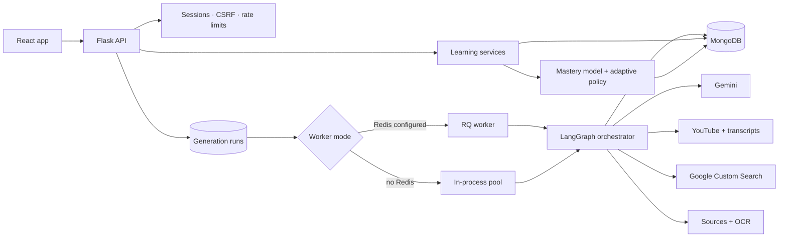
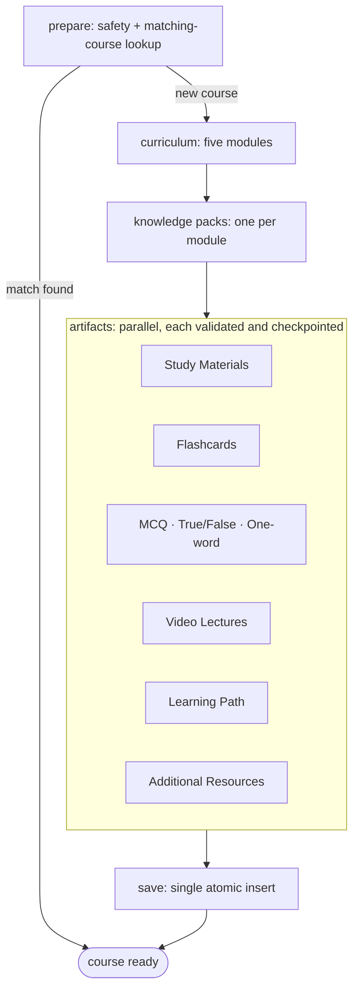
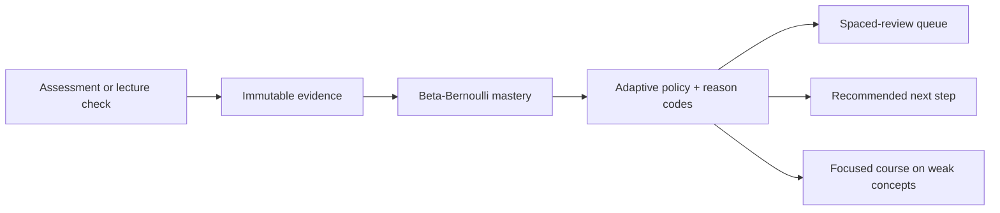

# Lexinit AI

**An adaptive learning platform that turns any topic, PDF, or photographed page into a complete five-module course, then keeps adjusting to how the learner actually performs.**

Each course combines Study Materials, Flashcards, three kinds of Assessments, a curated Video Lecture per module, a Learning Path, and Additional Resources. All of them are generated from one shared plan, so they never contradict each other. Assessment results feed a mastery model that schedules spaced reviews and recommends what to study next.

**Stack:** React 19 · TypeScript · TanStack Router/Query · Tailwind · Flask · Pydantic · LangGraph · RQ/Redis · MongoDB · Google Gemini · YouTube Data API · OpenTelemetry

---

## Contents

- [What a learner gets](#what-a-learner-gets)
- [Engineering highlights](#engineering-highlights)
- [Architecture](#architecture)
- [Tech stack](#tech-stack)
- [Project structure](#project-structure)
- [Running locally](#running-locally)
- [Configuration](#configuration)
- [Known limitations and next steps](#known-limitations-and-next-steps)
- [Further documentation](#further-documentation)

---

## What a learner gets

1. **Sign up and onboard.** Email verification by one-time code, then a learner profile (student, working professional, or independent learner) that personalises generated content.
2. **Create a course** from a topic, optionally grounded in uploaded PDFs or images, at easy, medium, or hard difficulty, in *Quick* or *Deep Focus* mode (a stronger reasoning model with its own quota).
3. **Study** five ordered modules: Study Materials (Markdown with LaTeX math, printable), animated Flashcards, and a Video Lecture with a transcript-based Lecture Guide and knowledge check.
4. **Get assessed** with Multiple Choice, True/False, and One-word questions, graded entirely on the server.
5. **Adapt.** Every answer updates per-concept mastery. Weak concepts produce targeted recommendations, a spaced-review queue, and the option to generate a focused course on just those concepts.
6. **Track progress** per course and overall, and earn completion badges.

A public waitlist page and a pricing page (Free, Plus, Pro plans with different daily generation limits) sit alongside the app.

---

## Engineering highlights

The design choices below are the parts of the project worth reading the code for.

### 1. Course generation is a durable, checkpointed workflow, not a long HTTP request

Generating a course takes many LLM and API calls, and any of them can fail. Instead of doing this inside a request, the API records a **generation run** in MongoDB and hands it to a worker. The orchestrator ([`backend/services/generation_jobs.py`](./backend/services/generation_jobs.py)) is a **LangGraph `StateGraph`**:

```text
prepare (safety check, reuse a matching course) → curriculum → knowledge packs → artifacts (parallel) → save
```

- **Checkpoint per step.** Each completed step and each artifact family is stored on the run. A retry reruns only what is missing or failed.
- **MongoDB is the source of truth, not the graph state**, so a crash loses nothing. Workers take a **time-limited lease** on a run, and incomplete runs are resumed on startup.
- **Pluggable execution.** `GENERATION_WORKER_MODE=auto` uses an **RQ/Redis** queue when Redis is configured and falls back to an in-process thread pool otherwise. The same code runs in development and production.
- **Parallel artifacts.** The eight artifact families are generated concurrently (thread pool of four), and cancellation is checked as each one finishes.
- **All or nothing.** A course is inserted only after every artifact passes validation, so learners never see a half-built course.
- **Fair quotas.** Daily generation limits are consumed with conditional atomic updates, so concurrent requests cannot exceed them. They are **refunded** if a run fails or is cancelled.

### 2. One plan per module keeps every artifact consistent

Separate LLM calls for notes, flashcards, and quizzes tend to drift apart. Lexinit first generates a **curriculum** (exactly five modules, each with concepts and measurable objectives) and then one **knowledge pack** per module: definitions, facts, examples, common mistakes, difficulty boundaries, source references, and video search terms.

Every artifact is generated *from* those packs and then **checked against them** before it is accepted. Each artifact carries **lineage** (curriculum, module, concept, and objective IDs, plus pack and prompt versions), so any question or card can be traced back to the objective it tests. IDs are derived from stable hashes, so the same plan produces the same IDs.

### 3. AI creates content; deterministic code makes decisions

The LLM never grades, authorises, or decides what a learner should do next.

- **Mastery model** ([`lexinit/domain/mastery/calculator.py`](./backend/lexinit/domain/mastery/calculator.py)): a Bayesian **Beta-Bernoulli** estimate per concept, starting from a Beta(2, 2) prior. Correct answers update α and incorrect ones update β, weighted by difficulty (0.8 / 1.0 / 1.2). The resulting probability maps to bands: weak (< 0.40), developing, proficient, and mastered (≥ 0.85).
- **Adaptive policy** ([`lexinit/domain/mastery/policy.py`](./backend/lexinit/domain/mastery/policy.py)): a pure function that chooses one of seven actions (misconception correction, prerequisite remediation, weak-topic remediation, targeted practice, application practice, difficulty progression, spaced review). Each decision is stored with **machine-readable reason codes** and the evidence IDs behind it, so every recommendation is explainable.
- **Spaced review.** The next review date follows the mastery band (1, 3, 7, or 14 days). Self-rated reviews (Again, Hard, Good, Easy) feed back in as weighted evidence.
- Both modules are pure Python with no I/O, sitting behind repository interfaces (`typing.Protocol`), so they can be tested in isolation.

### 4. Assessments are built to resist tampering

- The client receives questions **without answers**. Correct answers stay in a private question bank on the server.
- An attempt is created server-side, **expires after two hours**, and each answer is saved against it.
- Starting, answering, and finalising are **idempotent**: replaying a key returns the original result, and reusing a key for different data is rejected.
- Finalising requires a signed submission token (compared in constant time), rejects incomplete, expired, mismatched, or foreign attempts, grades against the stored answers, and writes an **immutable submission**. Only then is mastery evidence recorded.

### 5. Video Lectures are ranked, not just searched

For each module, the matcher runs several focused YouTube queries built from the knowledge pack.

- **Filtered out:** Shorts, non-embeddable videos, videos made for kids, non-English audio, and any video already used in another module.
- **Scored on:** concept coverage (45%), transcript coverage (30%), title and topic relevance (15%), and search rank and duration (10%).
- **Transcript re-check:** the top three candidates are re-scored against their actual transcripts.
- **No fallback:** if nothing clears the quality threshold, the step fails and can be retried, instead of silently using the first search result.

Lecture Guides and knowledge checks are grounded in the chosen video's transcript, but kept separate from the course's own answers, so an external video cannot change what counts as correct.

### 6. Uploaded sources are handled as untrusted input

- **Validation:** uploads are checked by extension, MIME type, *and* file signature (magic bytes). Limits are 10 MB per PDF, 150 pages, and 8 MB per image.
- **Extraction:** text is extracted page by page with PyMuPDF. Pages that contain only images go through **Google Cloud Vision OCR**, up to 30 pages.
- **Retrieval:** text is split into overlapping chunks (1,200 characters, 180 overlap), stored with hashes and page lineage, and retrieved with feature-hashed term vectors and cosine similarity.
- **Grounding:** the most relevant chunks are attached to the generation run, and knowledge packs record which source passages they used.

### 7. Structured LLM output with validation and model fallback

Prompts for the curriculum, knowledge packs, and practice questions ask Gemini for JSON that matches a **schema derived from the Pydantic model** ([`backend/clients.py`](./backend/clients.py)). The response is then **validated locally** with the same model. A configurable **fallback chain of models** is tried in order when a call fails. Prompts are versioned (for example `curriculum-v2`), and the version is stored on everything they produce.

### 8. Security and operations

- **Sessions and CSRF:** server-side sessions stored in MongoDB, and CSRF tokens on every state-changing request from a signed-in user.
- **Headers:** a strict Content Security Policy and other security headers.
- **Rate limits:** a sliding-window limiter, with separate budgets for uploads, generation, assessments, and waitlist signups.
- **Ownership:** checked on every course, source, attempt, and run, and all request bodies are validated by Pydantic.
- **Observability:** OpenTelemetry tracing, request IDs, liveness and readiness probes, and token-protected metrics and alert endpoints (error rate, p95 latency, database health).
- **Tooling:** encrypted **AES-256-GCM** database backups with restore verification, an additive migration script with a dry-run mode, and a load-test gate that fails above 1% errors or 1.5 s p95 latency.

---

## Architecture







---

## Tech stack

| Area | Technology |
| --- | --- |
| Frontend | React 19, TypeScript, Vite, TanStack Router (type-safe, file-based routes), TanStack Query, Tailwind CSS 4, Radix UI, Motion, Recharts, React Markdown + KaTeX, Zod, Lenis |
| Backend | Python 3.10+, Flask, Pydantic v2, LangGraph, RQ, Flask-Mail, Gunicorn, managed with `uv` |
| Data | MongoDB (with schema validation and indexes); Redis for the production job queue |
| AI and search | Google Gemini (structured JSON output), YouTube Data API, youtube-transcript-api, Google Custom Search |
| Documents | PyMuPDF / PyMuPDF4LLM, Google Cloud Vision OCR |
| Operations | OpenTelemetry, health/readiness/metrics/alert endpoints, encrypted backups, load-test gate |

---

## Project structure

```text
backend/
  app.py, worker.py        API entry point (WSGI `application`) and RQ worker
  routes/                  HTTP layer: parsing, auth, ownership checks, responses
  lexinit/
    domain/                Pure logic: grading, mastery model, adaptive policy
    services/              Learning workflows: assessments, reviews, video, sources, dashboard
    repositories/          MongoDB persistence behind Protocol interfaces
    schemas/               Pydantic contracts for requests, domain, and LLM output
    observability/         Request context, telemetry, alert evaluation
  services/                Generation orchestrator, run state, content generation
  scripts/                 Migration, encrypted backup, load test, DB check, seed user
frontend/
  src/routes/              Pages (TanStack file-based routing)
  src/components/          Shared UI and product components
  src/hooks/               Server-state hooks (current user, generation polling, session)
  src/lib/api.ts           Typed API client with CSRF handling and Zod validation
docs/                      Architecture, backend, frontend, runbook, design system, product language
```

---

## Running locally

**Prerequisites:** Python 3.10+, [uv](https://docs.astral.sh/uv/getting-started/installation/), Node.js, MongoDB (local or Atlas), and API keys for Gemini and the YouTube Data API.

### Backend

Create `backend/.env` from [`backend/.env.example`](./backend/.env.example), then:

```bash
cd backend
uv sync
uv run python app.py
```

The API runs at `http://127.0.0.1:5000`. Without `REDIS_URL`, course generation runs in an in-process worker, so nothing else is needed for development.

### Frontend

```bash
cd frontend
npm install
npm run dev
```

The app runs at `http://localhost:5173`.

### Single-server build

```bash
cd frontend
npm run build
cd ../backend
uv run python app.py
```

Flask serves the built React app from `frontend/dist`.

### Production

`app.py` starts Flask's debug server, which is for development only. In production, set `REDIS_URL` and run the API under a WSGI server and the worker as a separate process (both from `backend/`):

```bash
uv run gunicorn app:application
```

```bash
uv run python worker.py
```

See [docs/PRODUCTION_RUNBOOK.md](./docs/PRODUCTION_RUNBOOK.md) for release order, migration, backups, and alerting.

### Quality checks

```bash
cd frontend
npx tsc --noEmit
npm run lint
npm run build
```

```bash
uv run --project backend python -m compileall -q backend
```

---

## Configuration

All settings are environment variables. [`backend/.env.example`](./backend/.env.example) lists every variable; these are the main ones.

| Variable | Purpose |
| --- | --- |
| `FLASK_SECRET_KEY` | Session signing key (long and random in production) |
| `MONGO_URI` / `USE_LOCAL_MONGO` | Database connection |
| `GEMINI_API_KEY`, `GEMINI_MODEL_NAME`, `GEMINI_DEEP_FOCUS_MODEL_NAME`, `GEMINI_FALLBACK_MODEL_NAMES` | LLM access, the Deep Focus model, and the fallback chain |
| `YOUTUBE_API_KEY` | Video Lecture search |
| `CUSTOM_SEARCH_API`, `SEARCH_ID` | Additional Resources search |
| `GOOGLE_CREDENTIALS_BASE64` | Optional Google Cloud Vision OCR for scanned pages |
| `REDIS_URL`, `GENERATION_WORKER_MODE` | Job queue (`auto`, `rq`, or `local`) |
| `MAIL_*`, `MAIL_SUPPRESS_SEND` | Verification and reset emails (suppressed mode prints codes to the console) |
| `METRICS_TOKEN`, `OTEL_EXPORTER_OTLP_ENDPOINT` | Protected metrics and alerts, trace export |

---

## Known limitations and next steps

These are stated openly so reviewers know where the edges are:

- **No automated test suite yet.** The domain layer (grading, mastery, policy) is pure and dependency-free so it can be unit tested directly; adding pytest coverage there and CI on pull requests is the next priority.
- **Source retrieval is lexical.** Feature-hashed term vectors capture shared vocabulary but not meaning. Swapping in real embeddings (for example Gemini embeddings with a vector index) is a contained change inside `document_learning.py`.
- **Rate limiting is per process.** The sliding-window limiter is in memory, so with several Gunicorn workers each enforces its own budget. Moving it to Redis would make limits global.
- **One-word answers use exact matching** after normalisation (case and trailing punctuation). Lecture knowledge checks already use fuzzy matching; the same could apply here.
- **Waitlist signups are stored but not yet emailed or exported.**

---

## Further documentation

- [Project overview](./docs/PROJECT_OVERVIEW.md)
- [System architecture](./docs/ARCHITECTURE.md)
- [Backend architecture](./docs/BACKEND_ARCHITECTURE.md)
- [Frontend architecture](./docs/FRONTEND_ARCHITECTURE.md)
- [Production runbook](./docs/PRODUCTION_RUNBOOK.md)
- [Design system](./docs/DESIGN.md)
- [Product language](./docs/PRODUCT_LANGUAGE.md)
