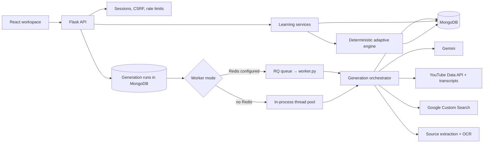
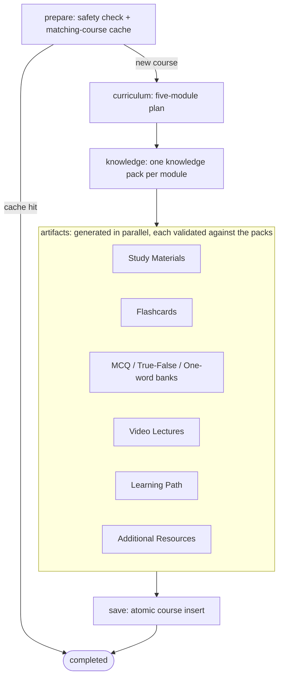

# Lexinit AI

Lexinit is a personalized learning workspace that turns a topic or uploaded source into a structured five-module course. Each course brings together Study Materials, Flashcards, Assessments, Video Lectures, Additional Resources, progress tracking, review scheduling, and adaptive recommendations.

## How it works

1. A learner registers, verifies their email with a one-time code, accepts the policies, and completes their learning profile.
2. The learner creates a course from a topic, optional source, difficulty, and generation mode.
3. Lexinit generates a curriculum and one authoritative knowledge pack per module.
4. Study Materials, Flashcards, Assessments, and Video Lectures are aligned to those module packs.
5. The learner progresses module by module and completes learning activities.
6. Assessments and lecture knowledge checks produce learning evidence.
7. The adaptive engine identifies weak concepts, schedules reviews, and recommends focused next steps.
8. Course-level and overall progress are available in the Progress dashboard; earned completion badges appear in the profile.

## Main capabilities

- Topic-based and source-grounded course creation
- Five-module Learning Path with activity completion
- Study Materials with printable export
- Stacked, animated Flashcards
- Secured Multiple Choice, True/False, and One-word Assessments
- Server-side answer validation and grading
- Weak-concept detection and focused-course generation
- Ranked, module-aligned YouTube Video Lectures
- Transcript-based Lecture Guides and knowledge checks
- Course and overall learning analytics
- Spaced-review queue and adaptive recommendations
- Student, professional, and independent-learner profiles
- Email-verified signup, password reset, and profile management
- Durable, checkpointed, retryable generation jobs
- Public waitlist page and pricing page

## Architecture



### Generation orchestration

Course creation runs as a durable job, not inside the HTTP request. The API records a generation run in MongoDB and hands it to a worker. The worker takes a time-limited lease on the run and executes the orchestrator in [backend/services/generation_jobs.py](./backend/services/generation_jobs.py). The orchestrator is a LangGraph `StateGraph`; if LangGraph is unavailable, the same steps run sequentially.



- **Checkpoints:** every step (`safety`, `cache`, `curriculum`, `knowledge_packs`, each `artifact:*`) is saved to the run as it completes. A retry reruns only missing or failed steps.
- **Alignment:** each artifact is checked against the curriculum and knowledge packs before it is checkpointed, and carries lineage (module, concept, objective, pack, source, and prompt-version IDs).
- **Failure handling:** a failed step marks the run as retryable (except safety failures), cancellation is honoured between steps, and the user's generation quota is refunded on failure or cancellation. Only a fully validated run creates a course.
- **Recovery:** runs left incomplete by a restart are resumed on startup (`GENERATION_RESUME_ON_STARTUP`).
- **Worker mode:** `GENERATION_WORKER_MODE=auto` (the default) uses RQ when `REDIS_URL` is set and falls back to the local thread pool otherwise; `rq` requires Redis; `local` always runs in-process.

### Learning and adaptation

Assessments are graded entirely on the server: the client never receives correct answers before submission, and each finalized attempt is stored as immutable evidence. That evidence updates concept mastery, and a deterministic policy (no AI) produces the review schedule, the recommended next step, and focused-course suggestions for weak concepts.

### Backend layers

```text
routes/                 HTTP parsing, authentication, ownership checks
lexinit/schemas/        Pydantic request, domain, and generation contracts
lexinit/domain/         Pure grading and mastery policies
lexinit/services/       Learning workflows (assessments, reviews, video, sources, dashboard)
lexinit/repositories/   MongoDB persistence
lexinit/observability/  Request context, telemetry, alerts
services/               Generation orchestration, run state, content generation
worker.py               RQ worker entry point
```

See [docs/ARCHITECTURE.md](./docs/ARCHITECTURE.md) and [docs/BACKEND_ARCHITECTURE.md](./docs/BACKEND_ARCHITECTURE.md) for details.

## Technology

| Area | Stack |
| --- | --- |
| Frontend | React 19, TypeScript, Vite, TanStack Router, TanStack Query, Tailwind CSS, Radix UI, Motion, Lenis, Recharts, React Markdown + KaTeX |
| Backend | Python, Flask, Pydantic, LangGraph, RQ, Flask-Mail |
| Data | MongoDB; Redis for production job queues |
| AI | Google Gemini structured generation |
| External learning | YouTube Data API, transcript retrieval, Google Custom Search |
| Documents | PyMuPDF/PyMuPDF4LLM with optional Google Vision OCR |
| Operations | OpenTelemetry, health/readiness endpoints, alert checks, encrypted backup tooling |

## Project structure

```text
backend/   Flask API, domain services, schemas, jobs, scripts
frontend/  React + Vite UI, routes, components, API contracts
docs/      Architecture, runbook, design system, product language
```

## Documentation

- [Project overview](./docs/PROJECT_OVERVIEW.md)
- [System architecture](./docs/ARCHITECTURE.md)
- [Backend architecture](./docs/BACKEND_ARCHITECTURE.md)
- [Frontend architecture](./docs/FRONTEND_ARCHITECTURE.md)
- [Production runbook](./docs/PRODUCTION_RUNBOOK.md)
- [Design system](./docs/DESIGN.md)
- [Product language](./docs/PRODUCT_LANGUAGE.md)

## Getting started

### Backend

Install [uv](https://docs.astral.sh/uv/getting-started/installation/), create
`backend/.env` from `backend/.env.example`, then run:

```powershell
cd backend
uv sync
uv run python app.py
```

`uv sync` creates and manages the project environment automatically; no manual
activation is needed.

`app.py` starts Flask's debug server, which is for local development only.

Generation runs are persisted in MongoDB. With no `REDIS_URL`, development uses
the built-in local worker. For production, configure Redis, serve the API with a
WSGI server such as Gunicorn (already a dependency; `app.py` exposes
`application`), and run the worker as a separate process:

```bash
# terminal 1 (from backend/)
uv run gunicorn app:application

# terminal 2 (from backend/)
uv run python worker.py
```

Backend URL:

```text
http://127.0.0.1:5000
```

### Frontend

```powershell
cd frontend
npm install
npm run dev
```

Frontend URL:

```text
http://localhost:5173
```

### Production-style local run

```powershell
cd frontend
npm install
npm run build
cd ..
cd backend
uv run python app.py
```

After a frontend build, Flask serves the React app from `frontend/dist`.

### Quality gates

```powershell
cd frontend
npm run lint
npx tsc --noEmit
npm run build
```
