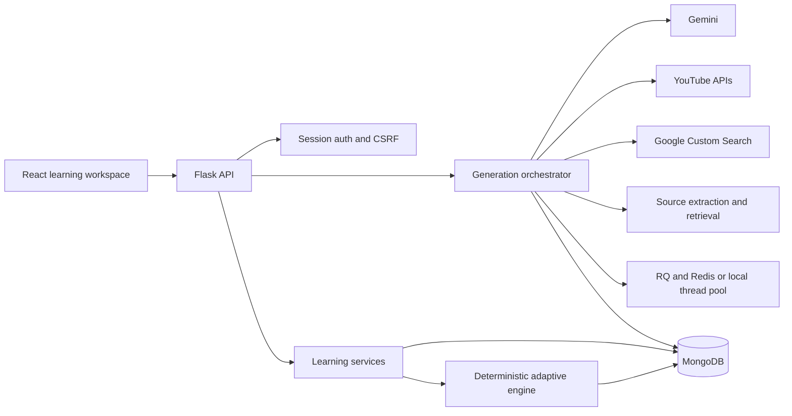
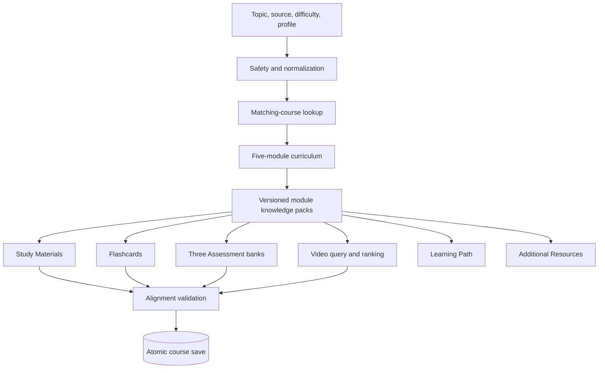
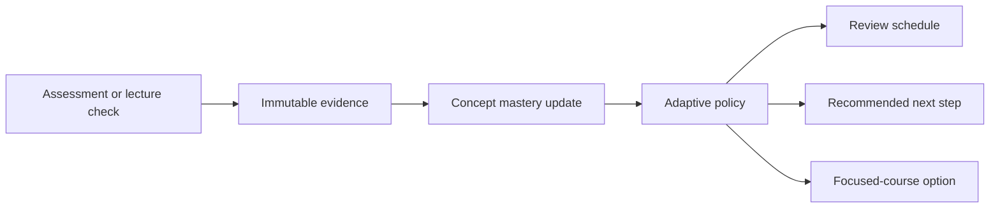

# Lexinit system architecture

## Design goals

- Keep every course artifact aligned to one curriculum.
- Keep grading, authorization, progress, and adaptation deterministic and server-controlled.
- Use AI for structured educational creation, not for access control or score calculation.
- Resume failed generation without regenerating completed work.
- Preserve traceability from course artifacts to modules, concepts, objectives, sources, and generation versions.
- Keep technical metadata out of learner-facing language.

## System map

Redis/RQ is the production queue. Development can use the built-in local generation worker when Redis is not configured. `GENERATION_WORKER_MODE` selects the behaviour: `auto` (default) uses RQ when `REDIS_URL` is set and otherwise falls back to the local worker, `rq` requires Redis, and `local` always runs in-process.

The generation orchestrator is a LangGraph `StateGraph` (`prepare → curriculum → knowledge → artifacts → save`, with a conditional exit from `prepare` on a cached course). When LangGraph is unavailable the same nodes run sequentially. MongoDB, not the graph state, is the durable source of truth: workers claim a run with a time-limited lease, and incomplete runs are resumed on startup when `GENERATION_RESUME_ON_STARTUP` is enabled.

## Course generation

The generation run stores a checkpoint for the curriculum, knowledge packs, and every artifact family. Artifact families are generated in parallel (up to four at a time). A retry preserves completed checkpoints and reruns only missing or failed artifacts. Failed or cancelled runs refund the learner's generation quota.

Each module knowledge pack contains concepts, definitions, objectives, facts, examples, common mistakes, difficulty boundaries, source references, and precise video search terms. Generated artifacts carry curriculum, module, concept, objective, pack, source, prompt-version, and validation lineage.

## Video selection

Each module receives one unique Video Lecture. The matcher:

1. Builds several focused queries from the topic and module pack.
2. Retrieves multiple candidates.
3. Rejects unavailable, non-embeddable, unsuitable-language, child-directed, Short, duplicate, and unsuitable-duration results.
4. Ranks metadata relevance, required-concept coverage, transcript coverage when available, and suitability.
5. Saves the best valid lecture and its traceability metadata.

There is no arbitrary first-result fallback. If a module has no suitable candidate, the Video Lecture artifact fails and retries; an incomplete new course is not saved.

## Learning and adaptation

Core Assessment answers are grounded in the module pack. Lecture Guides and lecture knowledge checks are grounded separately in the selected video transcript, so an external lecture cannot change the course’s authoritative answers.

## Security and data integrity

- Cookie-based sessions, ownership checks, CSRF protection, content security policy, safe IDs, and request validation
- Complete server-side Assessment validation and grading
- Correct answers excluded from pre-submission responses
- Idempotency for generation, submissions, and lecture checks
- Source text treated as untrusted educational data
- MongoDB uniqueness and lineage fields for durable replay protection
- Health, readiness, metrics, alert, migration, backup, and load-test tooling

## Compatibility

New courses use the knowledge-pack pipeline. Existing sessions remain readable because the new fields are additive and consumers tolerate their absence. Existing progress and scores are not silently replaced.

See [BACKEND_ARCHITECTURE.md](./BACKEND_ARCHITECTURE.md) and [FRONTEND_ARCHITECTURE.md](./FRONTEND_ARCHITECTURE.md) for implementation details.
